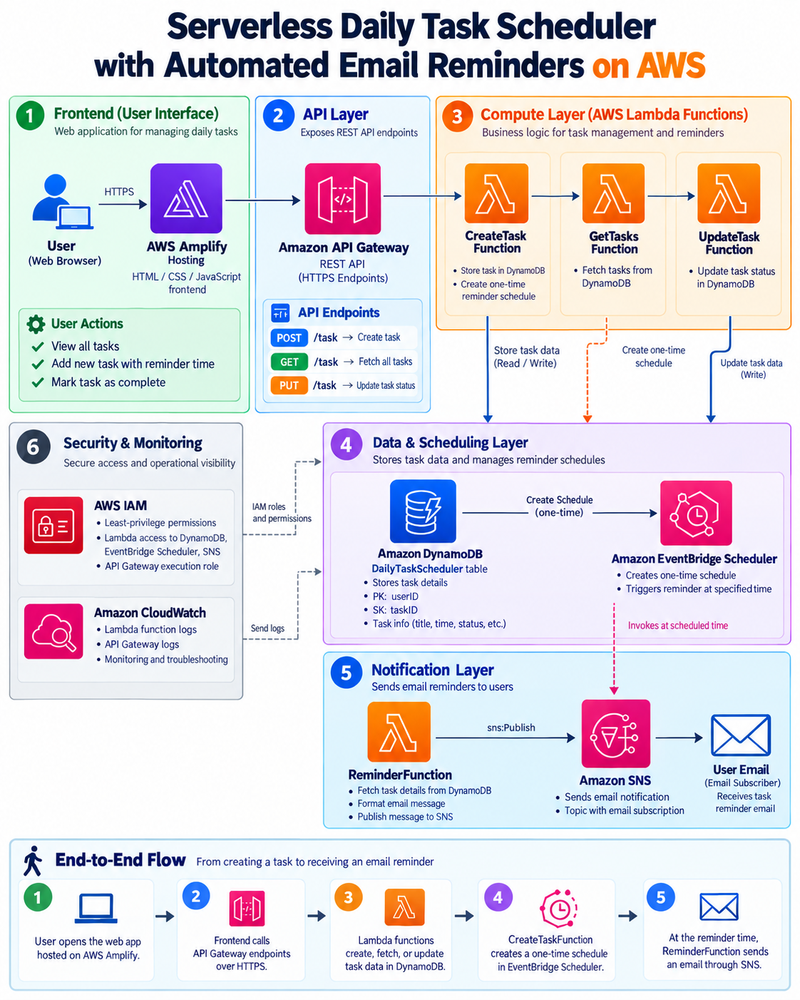

# Serverless Daily Task Scheduler with Automated Email Reminders on AWS

A beginner-friendly serverless cloud project built on AWS. The application allows users to create daily tasks, view existing tasks, mark tasks as completed, and receive automated email reminders at a configured reminder time.

## Live Demo

**Frontend:** https://main.d13amy4oapg5sg.amplifyapp.com

> The demo API is intentionally simple and does not currently include user authentication. See the Security Notes section before exposing a production deployment publicly.

## Architecture



### End-to-End Flow

1. The user opens the web application hosted on **AWS Amplify**.
2. The frontend calls **Amazon API Gateway** over HTTPS.
3. API Gateway routes requests to separate **AWS Lambda** functions.
4. Lambda functions create, retrieve, or update tasks in **Amazon DynamoDB** using Boto3.
5. `CreateTaskFunction` also creates a one-time **Amazon EventBridge Scheduler** schedule for the requested reminder time.
6. At the reminder time, EventBridge Scheduler invokes `ReminderFunction`.
7. `ReminderFunction` publishes the reminder to an **Amazon SNS** topic.
8. SNS delivers the reminder to a confirmed email subscriber.
9. **Amazon CloudWatch** stores Lambda logs for monitoring and troubleshooting.
10. **AWS IAM** roles and policies provide least-privilege access between services.

## AWS Services Used

| Service | Purpose |
|---|---|
| AWS Amplify Hosting | Hosts the HTML/CSS/JavaScript frontend |
| Amazon API Gateway | Exposes HTTPS API endpoints |
| AWS Lambda | Serverless backend logic |
| Amazon DynamoDB | Stores task data |
| Amazon EventBridge Scheduler | Creates one-time reminder schedules |
| Amazon SNS | Sends reminder emails |
| AWS IAM | Least-privilege permissions between services |
| Amazon CloudWatch | Lambda logging and troubleshooting |

## Features

- Create a task
- View all tasks for a user
- Mark a task as completed
- High / Medium / Low priorities
- Fixed-event flag
- Reminder time for every task
- Automatic EventBridge reminder creation
- Automated email notification through SNS
- Responsive frontend
- Public deployment with AWS Amplify
- Serverless architecture with no EC2 instances to manage

## API Endpoints

| Method | Route | Purpose |
|---|---|---|
| `POST` | `/task` | Create a new task and reminder |
| `GET` | `/task?userID=demo-user` | Retrieve tasks for a user |
| `PUT` | `/task` | Update an existing task |

### Example POST request

```json
{
  "userID": "demo-user",
  "taskName": "Study AWS Lambda",
  "taskDate": "2026-10-05",
  "startTime": "20:00",
  "endTime": "21:00",
  "durationMinutes": 60,
  "priority": "HIGH",
  "fixedEvent": false,
  "reminderTime": "19:50"
}
```

## DynamoDB Design

**Table:** `DailyTaskScheduler`

- Partition key: `userID`
- Sort key: `taskID`

Example item:

```json
{
  "userID": "demo-user",
  "taskID": "generated-uuid",
  "taskName": "Study AWS Lambda",
  "taskDate": "2026-10-05",
  "startTime": "20:00",
  "endTime": "21:00",
  "durationMinutes": 60,
  "priority": "HIGH",
  "status": "PENDING",
  "fixedEvent": false,
  "reminderTime": "19:50"
}
```

## Lambda Functions

### `CreateTaskFunction`

- Generates a UUID for each new task
- Stores the task in DynamoDB with `PutItem`
- Creates a one-time EventBridge Scheduler schedule
- Passes task details to `ReminderFunction`

Required environment variables:

```text
REMINDER_FUNCTION_ARN
SCHEDULER_ROLE_ARN
```

### `GetTasksFunction`

- Queries DynamoDB using `userID`
- Converts DynamoDB `Decimal` values before returning JSON

### `UpdateTaskFunction`

- Updates selected task attributes using DynamoDB `UpdateItem`
- Used by the frontend to mark tasks as completed

### `ReminderFunction`

- Receives the scheduled reminder payload
- Publishes a message to Amazon SNS
- Produces CloudWatch logs

Required environment variable:

```text
SNS_TOPIC_ARN
```

## IAM / Least Privilege

The project uses separate permissions for each workload:

- `CreateTaskFunction`: `dynamodb:PutItem`, `scheduler:CreateSchedule`, scoped `iam:PassRole`
- `GetTasksFunction`: `dynamodb:Query`
- `UpdateTaskFunction`: `dynamodb:UpdateItem`
- EventBridge Scheduler execution role: `lambda:InvokeFunction` on `ReminderFunction`
- `ReminderFunction`: `sns:Publish` on the reminder SNS topic

This keeps access limited to what each component actually needs.

## CORS

The frontend and API are on different domains, so API Gateway CORS is configured for the Amplify origin.

Example:

```text
Allow-Origin:
https://main.d13amy4oapg5sg.amplifyapp.com

Allow-Headers:
content-type

Allow-Methods:
GET
POST
PUT
OPTIONS
```

## Local Development

From the directory containing `index.html`:

```powershell
python -m http.server 5500
```

Open:

```text
http://localhost:5500
```

If localhost is used, temporarily include `http://localhost:5500` in the API Gateway CORS allowed origins.

## Deployment

### Frontend

The frontend is deployed using **AWS Amplify Hosting**.

For manual deployment, zip the contents of the frontend directory so that `index.html` is at the root of the archive.

Correct:

```text
site.zip
└── index.html
```

### Backend

Backend resources are configured in AWS:

- API Gateway HTTP API
- Lambda functions
- DynamoDB table
- EventBridge Scheduler
- SNS topic and confirmed email subscription
- IAM roles/policies

## Troubleshooting Lessons

Some issues encountered while building the project:

- **DynamoDB key names are case-sensitive** (`userID` and `taskID`)
- DynamoDB numbers are returned as Python `Decimal` objects and require JSON conversion
- Browser calls required API Gateway **CORS**
- Opening the frontend through `file://` produced an origin of `null`; running a local HTTP server fixed it
- Lambda needs explicit IAM permission for each AWS service it calls
- EventBridge Scheduler needs an execution role that trusts `scheduler.amazonaws.com`
- `CreateTaskFunction` needs `iam:PassRole` when assigning the Scheduler execution role
- SNS email subscriptions must be confirmed
- The SNS topic environment variable must contain the complete topic ARN

## Security Notes

This project was built as a first AWS learning project.

Current limitations:

- No user authentication
- `demo-user` is currently used by the frontend
- API Gateway endpoints are publicly reachable
- CORS is **not** an authentication mechanism

For a production deployment, recommended improvements include:

- Amazon Cognito authentication
- Per-user identity instead of `demo-user`
- API authorization
- Request validation
- API throttling / quotas
- AWS WAF where appropriate
- Infrastructure as Code using Terraform or AWS CloudFormation

## Project Structure

```text
.
├── index.html
├── README.md
├── architecture/
│   ├── serverless_daily_task_scheduler_on_aws.png
│   ├── serverless_daily_task_scheduler_on_aws.pdf
│   └── serverless_daily_task_scheduler_first_diagram.pdf
└── lambdas/
    ├── create_task.py
    ├── get_tasks.py
    ├── update_task.py
    └── reminder.py
```

## What I Learned

This project helped me practice:

- Designing a serverless AWS architecture
- Building HTTP APIs using API Gateway
- Writing AWS Lambda functions in Python
- Working with DynamoDB NoSQL data models
- Using Boto3 to connect AWS services
- Implementing least-privilege IAM permissions
- Scheduling one-time events with EventBridge Scheduler
- Sending notifications through SNS
- Debugging Lambda using CloudWatch
- Configuring browser CORS
- Hosting a static application with AWS Amplify

## Future Improvements

- Amazon Cognito authentication
- Per-user task isolation
- Delete-task functionality
- Better reminder preferences
- Amazon SES for branded HTML email
- Amazon Bedrock for AI-based schedule optimization
- Infrastructure as Code
- Automated CI/CD deployment
- Unit and integration tests

## Author

Built as a hands-on AWS cloud engineering project.
